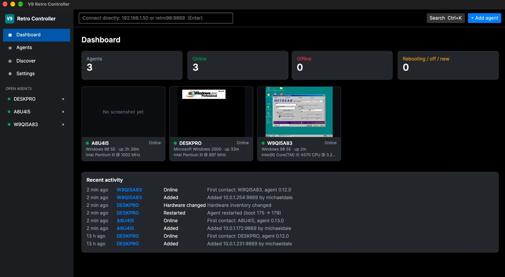
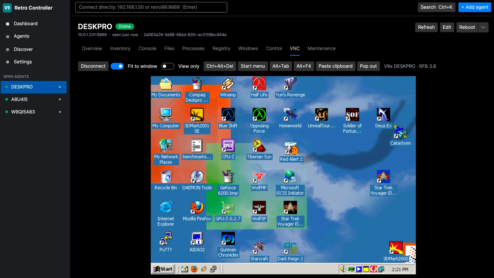

# V9 Retro Controller

A fast desktop app for watching and driving Windows 95, 98 and 2000 (and DOS) machines that run
the [V9x Remote Agent](https://github.com/michaeldale/V9x-Remote-Agent): status, screenshots,
inventory, a command console, files, processes, registry, input, power, agent updates and a
built-in VNC viewer, for a whole fleet at once. It finds agents on your network by itself.





## Download

Windows: grab `V9RetroController-<version>-win-x64.exe` from
[Releases](https://github.com/michaeldale/V9-Retro-Controller/releases). It is one
self-contained file: no installer, no .NET to install. Run it, and it keeps itself up to date
(Settings → Updates).

macOS: the app runs on macOS too (Apple Silicon and Intel, built with `scripts/build-mac.sh`),
but release downloads are Windows-only for now; the Mac app will be added to a later release.

## Important: read this first

- **The agent has no authentication.** The V9x Remote Agent protocol is designed for a trusted
  local network (a lab, a bench of retro PCs, a VM host). Anyone who can reach an agent's port
  (9869) can run programs, change files and reboot that machine, and the same goes for its VNC
  server (5900) unless it has a password. Keep agents on a LAN you trust, never expose them to
  the internet, and use the agent's `AGENT.INI` `allowed_client` setting to accept only the
  computer that runs this app.
- **This app is a LAN tool too.** It talks to agents over plain TCP. Its optional remote-access
  mode (below) is HTTPS with tokens, but it only tunnels to private LAN addresses and is meant
  for your own computers, not for publishing a fleet online.
- **Remote Help is off by default.** The agent also has a Remote Help feature (an outbound relay
  through the update server, so a machine behind NAT can be helped). It exists to help with
  development and testing of [Velocity9x](https://github.com/michaeldale/velocity9x), is off
  unless the machine's owner turns it on in the agent's SETUP.EXE, and is not used by this app.
  See the agent's [remote help documentation](https://github.com/michaeldale/V9x-Remote-Agent/blob/main/docs/remote-help.md).
- **Updates are signed.** App and agent updates come from michaeldale.com.au and are installed
  only if their release file verifies under the V9x Ed25519 release key and the download matches
  it, so the server and the plain-HTTP transport are not trusted.

## Features

- **Fleet.** Dashboard with counts, a card per machine with its latest screenshot, and recent
  activity. A sortable, filterable table with bulk poll, screenshot and pause. Background polling
  that keeps running when the window is closed to the tray.
- **Discovery.** mDNS (`_v9xremote._tcp`, agent 0.8.0+): add what it finds, or control a machine
  without saving it. Agents are tracked by their install UUID, so a changed DHCP address is
  followed and a different machine at a saved address is flagged.
- **Quick connect and Ctrl+K.** Type an address in the top bar, or search for any agent or action.
- **Per agent:** live screenshots and history, inventory (CPU, memory, drives, display, network,
  Windows, BIOS, devices with problem codes), a command console with streamed output, a file
  browser with drag-and-drop upload, processes, a read-only registry browser, the window list,
  click-and-type through the agent's input when VNC is off, reboot, shut down and hard reset.
- **VNC viewer** for the agent's V9XVNC.EXE, with scaling, special keys, clipboard and pop-out.
  VNC can also be started, stopped, enabled and disabled from the app.
- **Agent updates** from michaeldale.com.au: directly (agent 0.13.1+ downloads and stages its own
  update, then it is hot-swapped in without a reboot), through this PC (any agent from 0.6.0),
  or from a package folder.
- **Remote access.** One Windows PC can host its agents, history and polling for other copies of
  the app (a Mac, say): Settings → Remote access → Add client on the host, then Settings →
  Connection → Connect to a host on the other computer. HTTPS with a pinned self-signed
  certificate and a revocable token per client; agent and VNC traffic is tunnelled through the
  host.

## Build

Needs the .NET 10 SDK.

```
dotnet build V9Retro.sln
dotnet test V9Retro.sln
dotnet run --project src/V9Retro.App
```

- Windows exe: `powershell -NoProfile -ExecutionPolicy Bypass -File scripts\build-windows.ps1`
  writes `dist\V9RetroController-<version>-win-x64.exe` and the update package
  `dist\v9-retro-controller-<version>-win-x64.zip`.
- macOS app: `./scripts/build-mac.sh` (or `osx-x64`) on a Mac writes `dist/V9 Retro Controller.app`
  and `dist/v9-retro-controller-<version>-osx-arm64.zip`, ad-hoc signed (right-click → Open the
  first time on another Mac).

`V9RETRO_DATA` overrides the data folder (default `%LOCALAPPDATA%\V9RetroController`, or
`~/Library/Application Support/V9RetroController`); `V9RETRO_UPDATE_SERVER` points the updater
at another server for testing.

## Releasing

Releases follow the V9x Remote Agent's process. [CHANGELOG.md](CHANGELOG.md) is the release
information: its top section must match `<Version>` in `Directory.Build.props`, and becomes the
GitHub release notes and the notes the in-app updater shows.

1. Bump `<Version>`, add the CHANGELOG section, commit.
2. `scripts\build-windows.ps1` (and, when Mac builds ship, `scripts/build-mac.sh` on a Mac, copying
   its zip into `dist\`).
3. `scripts\publish-github.ps1 -Tag` publishes a scrubbed snapshot of the source to this
   repository as one `Release x.y.z` commit and tags it.
4. `scripts\release.ps1 -Publish` writes SHA256SUMS.txt and SIGNED.TXT (signed offline with the
   V9x release key) and creates the GitHub release with the exe, the update package and the
   CHANGELOG notes.
5. On the update server, `updates_publish_github_release` with app `v9-retro-controller` mirrors
   it; clients see it at their next check.

## Layout

| Project | |
|---|---|
| `src/V9Retro.Protocol` | Agent wire protocol: frame codec, typed session, BMP decoder |
| `src/V9Retro.Discovery` | mDNS / DNS-SD browser for `_v9xremote._tcp.local` |
| `src/V9Retro.Vnc` | RFB client for the agent's V9XVNC.EXE |
| `src/V9Retro.Core` | SQLite store, status poller, agent, maintenance and update services |
| `src/V9Retro.Remote` | Local backend, HTTPS API server, and the remote client |
| `src/V9Retro.App` | Avalonia UI |

## License

BSD 2-Clause; see [LICENSE](LICENSE).
